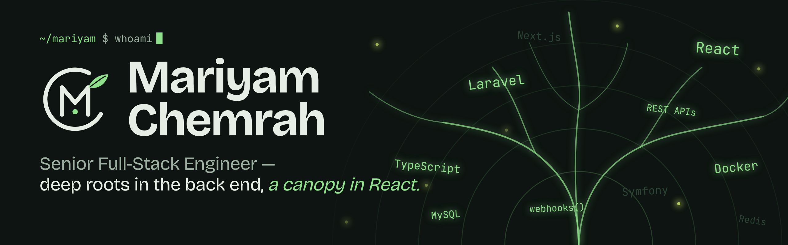

<!--
  Mariyam Chemrah — GitHub profile README

-->

<a href="https://www.mariyamchemrah.com/en/hire">
  <picture>
    <source media="(prefers-color-scheme: dark)" srcset="assets/banner-dark.png">
    <source media="(prefers-color-scheme: light)" srcset="assets/banner-light.png">
    
  </picture>
</a>

<p align="center">
  <a href="https://www.mariyamchemrah.com/en/hire"></a>
  
  
</p>

<p align="center">
  <a href="https://www.mariyamchemrah.com/en/hire"></a>
  <a href="https://www.linkedin.com/in/mariyam-chemrah-2a236199/"></a>
  <a href="mailto:mariam.chemrah@gmail.com"></a>
  <a href="https://www.mariyamchemrah.com/work"></a>
</p>


## `$ whoami`

I’m a **full-stack engineer with 8+ years** of designing, building and maintaining web applications — SaaS platforms, REST APIs, dashboards, CMS solutions, e-commerce and the integrations that glue them together.

My roots are in **PHP (Laravel, Symfony)**; my canopy is **React, Next.js and TypeScript**. I own the whole lifecycle — technical design and data modelling, implementation, testing, deployment and long-term maintenance — and I care about code that stays healthy long after launch.

```ts
const mariyam = {
  role:      "Senior Full-Stack Engineer",
  location:  "Casablanca, Morocco — remote-friendly, overlaps EU hours",
  roots:     ["PHP 8+", "Laravel", "Symfony", "API Platform", "Python / FastAPI"],
  canopy:    ["React", "Next.js", "TypeScript", "Tailwind CSS"],
  soil:      ["MySQL", "MongoDB", "Redis", "Docker", "GCP"],
  growingIn: "API-first, full-stack TypeScript architectures",
  languages: { arabic: "native", french: "B2+", english: "B2 · professional" },
  openTo:    ["senior full-stack roles", "freelance projects"],
};
```


## A root system, not a buzzword list

> What users see grows from what they don’t.

**Canopy** — what users touch

<p>
       
</p>

**Roots** — back end · data · infrastructure · integrations

<p>
      
  <br>
        
  <br>
    
</p>

<sub><code>REST APIs</code> · <code>webhooks</code> · <code>OAuth / tokens</code> · <code>async queues</code> · <code>SOLID</code> · <code>clean code</code> · <code>code reviews</code> · <code>testing</code> · <code>Agile / Scrum</code></sub>


## Projects with deep roots

<table>
  <tr>
    <td width="50%" valign="top">
      <h3><a href="https://github.com/Mariyame/mywall.fr">My Wall</a></h3>
      <sub><code>E-COMMERCE · MARKETPLACE</code></sub>
      <p>Open marketplace where independent artists upload their work and sell it as wall art, home decor and lifestyle products — with PayPal and CMI payments.</p>
        
    </td>
    <td width="50%" valign="top">
      <h3><a href="https://www.autodealersdigital.com/">Dealer Site Builder</a></h3>
      <sub><code>SAAS · AUTOMOTIVE</code></sub>
      <p>SaaS website builder for car dealerships — event-driven REST endpoints, webhooks with token auth and asynchronous queued jobs.</p>
        
      <a href="https://www.autodealersdigital.com/"><b>Live site →</b></a>
    </td>
  </tr>
  <tr>
    <td width="50%" valign="top">
      <h3><a href="https://github.com/Mariyame/ga4-automation">GA4 Automation</a></h3>
      <sub><code>ANALYTICS · AUTOMATION</code></sub>
      <p>Creates and manages Google Analytics 4 properties and data from code, replacing manual setup.</p>
       
    </td>
   <td width="50%" valign="top">
      <h3><a href="https://www.europemarocimmo.com/">Europe Maroc Immobilier</a></h3>
      <sub><code>REAL ESTATE · WEBSITE</code></sub>
      <p>Website for a Moroccan real estate agency with offices in Casablanca, Marrakech and Oujda — sale and rental listings with search by city and property type, furnished rentals, property management and B2B pages.</p>
         &nbsp;<a href="https://www.europemarocimmo.com/"><b>Live site →</b></a>
    </td>
  </tr>
  <tr>
    <td colspan="2" valign="top">
      <h3><a href="https://github.com/Mariyame/Mariyam-Chemrah">Portfolio — “Choose your path”</a></h3>
      <sub><code>NEXT.JS · DESIGN · MOTION</code></sub>
      <p>My nature-themed portfolio: a landing split between sky and soil, a cursor “lantern” that digs up glowing roots, two themed sites (clients &amp; recruiters) and EN / FR / AR with RTL.</p>
         &nbsp;<a href="https://www.mariyamchemrah.com"><b>Live site →</b></a>
    </td>
  </tr>
</table>


## Growth rings

| | Role | Where |
|:--|:--|:--|
| **2024 — now** | **Independent Full-Stack Developer** — websites and web apps with React / Next.js, TypeScript and Symfony | Casablanca · freelance |
| **2022 — 2024** | **PHP Full-Stack Developer** — SaaS website builder (Laravel + WordPress), event-driven REST APIs &amp; webhooks with token auth and async queues, GA4 automation, lead-tracking personalisation, custom WP plugins | Auto Dealers Digital |
| **2021 — 2022** | **Web Developer** — responsive UIs with Twig templates, e-commerce on Sylius | Delit D’Influence · remote |
| **2019 — 2021** | **E-commerce Full-Stack Developer** — open marketplace for independent artists on Laravel, PayPal &amp; CMI payments | My Wall |
| **2014 — 2018** | **Junior Web Developer &amp; Intern** — small-business websites (PHP, WordPress, JS), internal PHP tooling | Irma Service |

<details>
<summary><b>Where it was planted</b> — education, certifications &amp; languages</summary>
<br>

| | |
|:--|:--|
| **Université Paris 13** | Professional Bachelor’s — Web &amp; Mobile Development · 2018–2019 |
| **Specialized Institute of Applied Technology** | Technician Diploma — Software Development · 2012–2014 |
| **DELF B2** | Institut français de Casablanca · 2022 |
| **Voxy Proficiency** | High Intermediate · 2025 |
| **Languages** | Arabic (native) · French (B2+) · English (B2, professional) |

</details>


## How I engineer

<table>
  <tr>
    <td width="25%" valign="top"><code>clean_code()</code><br><b>SOLID &amp; OOP</b><br><sub>Design patterns that keep large codebases readable.</sub></td>
    <td width="25%" valign="top"><code>review &amp;&amp; test</code><br><b>Reviews &amp; tests</b><br><sub>Code reviews, Git workflows and tests on every change.</sub></td>
    <td width="25%" valign="top"><code>queue:work</code><br><b>Performance</b><br><sub>Async queues, Redis caching and lean queries.</sub></td>
    <td width="25%" valign="top"><code>README.md</code><br><b>Agile &amp; documented</b><br><sub>Scrum rituals and docs teammates can build on.</sub></td>
  </tr>
</table>


## Above ground — on GitHub

<!-- Optional live cards (free public service, sometimes rate-limited). Delete this block if a card ever shows an error. -->
<p align="center">
  <picture>
    <source media="(prefers-color-scheme: dark)" srcset="https://github-readme-stats.vercel.app/api?username=Mariyame&show_icons=true&hide_border=true&bg_color=0D1411&title_color=8EE08A&text_color=E6EDE4&icon_color=C9E26A&ring_color=8EE08A">
    
  </picture>
  <picture>
    <source media="(prefers-color-scheme: dark)" srcset="https://github-readme-stats.vercel.app/api/top-langs/?username=Mariyame&layout=compact&hide_border=true&bg_color=0D1411&title_color=8EE08A&text_color=E6EDE4">
    
  </picture>
</p>


<p align="center">
  <a href="https://www.mariyamchemrah.com/en/hire"></a>
  <a href="https://www.mariyamchemrah.com/work"></a>
  <a href="https://www.linkedin.com/in/mariyam-chemrah-2a236199/"></a>
</p>

<p align="center">
  <picture>
    <source media="(prefers-color-scheme: dark)" srcset="assets/footer-dark.png">
    
  </picture>
</p>
